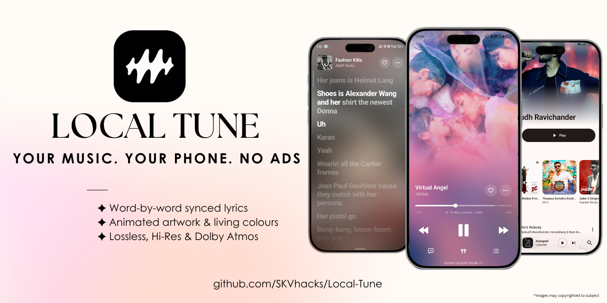
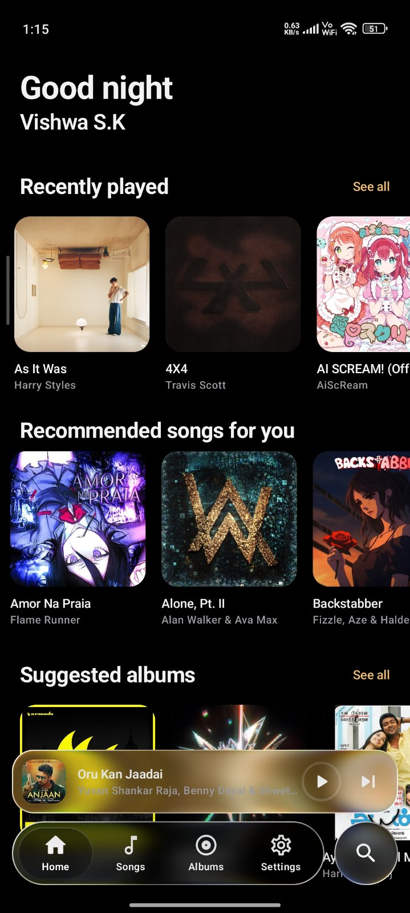
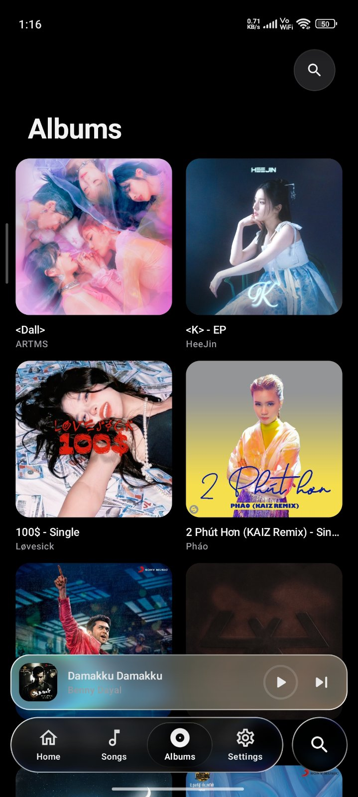
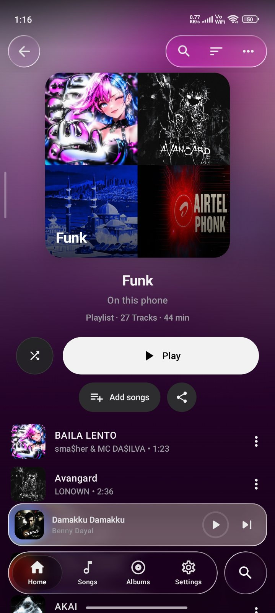

<p align="center">
  
</p>

<h1 align="center">LocalTune</h1>

<p align="center">
  <b>A beautiful, fully offline music player for the songs on your phone and your Windows PC.</b><br>
  Word-by-word synced lyrics · animated artwork and living colours · Lossless, Hi-Res and Dolby Atmos
</p>

<p align="center">
  <a href="../../releases/latest"></a>
  
  
  
</p>

LocalTune plays the music files you already have, with a clean player inspired by the best music
apps. No account, no streaming, no ads, no tracking: your music stays on your device.

It comes as an **Android app** and a native **Windows app**, built from this one repository. Both
read the same kind of music folders, and you can move your playlists, likes and listening
history between them.

---

## Screenshots

### Windows

| Home | Full-screen player |
|:---:|:---:|
|  |  |
| **Synced lyrics** | **Home, more shelves** |
|  |  |
| **Mini player** | **Mini player with lyrics** |
|  |  |

### Android

| Home | Synced lyrics | Animated artwork |
|:---:|:---:|:---:|
|  |  |  |
| **More of Home** | **Songs** | **Albums** |
|  |  |  |
| **Album page** | **Suggested albums** | **Playlist** |
|  |  |  |

---

## Features

### Lyrics (both apps)
- Reads **`.ttml`** (the Apple Music format) and **`.lrc`** lyric files kept next to your songs.
- **Word-timed lyrics** sweep letter by letter as they're sung; **line-timed lyrics** light up a line at a time.
- Overlapping lines, duets and **background vocals** are shown the way they're sung.
- Instrumental breaks show animated dots. Tap any line to jump to it.
- **"Written by"** credits after the last line, when the lyric file names the songwriters.

### Player
- **Flow background**: a soft, slowly moving background made from the colours of the album cover.
- **Quality badge**: Lossless, Hi-Res Lossless or Dolby Atmos, with the exact bit depth and sample rate.
- **Animated artwork** (Android): put a video named `tall_animated_artwork.mp4` in a song's folder and it plays full-screen behind the player, melting into the background.
- **Full-screen player** (Windows): cover and controls on the left, lyrics on the right. It moves to the centre when a song has no lyrics.
- **Mini player** (Windows): a small window that stays above everything else, tinted with the cover's colours, with lyrics and the queue a click away.

### Sound
- **Pure output** (Android, on by default): every file's audio is played untouched, with no equalizer, effects or loudness levelling.
- **Bit-perfect USB output** (Android 14+): a USB DAC is switched to each song's own sample rate and bit depth.
- **Bluetooth codec** shown under the seek bar on Android (for example *Lossless - LDAC*).
- **Exact seeking** in every FLAC file on Windows, even files without a seek table, so the lyrics always match what you hear.
- Plays MP3, AAC, FLAC, ALAC (Apple Lossless), WAV, Opus, Vorbis and more.

### Library
- **Home**: Recommended songs for you, Suggested albums, Recently played, Playlists, Artists, Folders and **Replay** (your most played).
- **Songs, Albums, Artists and Folders** pages, with filters and sorting on Windows.
- **Artist pages** with the artist's photo, taken from your song files, or from Deezer's free public catalogue if you allow it.
- Playlists, Liked songs, queue, search and listening history, all stored on your device.
- **Autoplay** carries on with similar songs from your library when an album or playlist ends.

---

## Download

Get the latest version from the [**Releases**](../../releases) page.

### Android

| File | For |
|---|---|
| `LocalTune-arm64-v8a.apk` | Almost all phones from the last several years (**recommended**) |
| `LocalTune-armeabi-v7a.apk` | Older 32-bit phones |
| `LocalTune-x86_64.apk` | Emulators and Chromebooks |
| `LocalTune-universal.apk` | Any device, if you're not sure (larger download) |

Requires **Android 8.0** or newer.

### Windows

| File | What it is |
|---|---|
| `LocalTune-Setup-x64.exe` | Installer (**recommended**): adds LocalTune to the Start menu. No administrator rights needed. |
| `LocalTune-x64.exe` | The whole app in one file: double-click to run, nothing to install. The first start takes a few seconds longer. |
| `LocalTune-windows-x64.zip` | The app as a folder: unzip and run `LocalTune.exe`. |

Requires **64-bit Windows 10** (version 1809 or later) or **Windows 11**.

### Android permissions

LocalTune asks for these the first time it opens. Each one is optional; the app works without the
ones you decline, minus that feature.

| Permission | Why |
|---|---|
| Music and audio | To find and play your songs |
| Photos and videos | To play animated artwork videos stored next to your songs |
| Nearby devices | To show which Bluetooth codec your headphones are using |
| Notifications | For the playback controls in the notification shade |

---

## Organising your music

LocalTune finds your songs by itself: on Android every song on the phone, on Windows the folders you
add in **Settings**. To get lyrics, covers and animated artwork too, keep each album in its own
folder, with the extra files **next to the songs**:

```
Music/
└── K-C-J Pop/                        ← any folder name
    └── _Dall_/                       ← one folder per album
        ├── cover.jpg                 ← album cover
        ├── tall_animated_artwork.mp4 ← full-screen animated artwork (Android)
        ├── Virtual Angel.flac        ← the song
        ├── Virtual Angel.ttml        ← its lyrics (word-by-word)
        ├── Unf_Air.flac
        └── Unf_Air.lrc               ← its lyrics (line-by-line)
```

| File | What it does |
|---|---|
| `Song.flac` (or `.mp3`, `.m4a`, `.wav`, `.opus`…) | The song. Title, artist and album come from its tags. |
| `Song.ttml` | Lyrics with **word or syllable timing**, background vocals and duets. Must have **exactly the same name** as the song. |
| `Song.lrc` | **Line-timed** lyrics (enhanced word-timed LRC works too). Same name as the song. |
| `cover.jpg` / `folder.jpg` | The album cover, when it isn't embedded in the song files. A cover inside the files is used first. |
| `tall_animated_artwork.mp4` | Android: plays full-screen behind the player for every song in the folder. |

**Tips**
- **On Android, lyrics need one extra step:** Android doesn't let apps read text files beside your music on their own, so open **Settings › Lyrics › Lyrics folders** and pick your music folder once.
- Lyrics can also go in a `Lyrics` folder inside the album folder.
- If a song has both, `.ttml` is used before `.lrc`.

---

## Backup, and moving between phone and PC

Your liked songs, playlists and listening history can travel between devices in one file.

- **Android:** Settings › Music and storage › Backup › **Export data** / **Import data**.
- **Windows:** Settings › Backup › **Export a backup** / **Import a backup**.

The file, `localtune-backup-YYYY-MM-DD.json`, works on both: export on your phone and import on your
PC, or the other way round. Songs are matched by **title and artist**, so the same music can sit in
different folders on each device. On Windows, importing adds to what's there; importing the same
file twice adds nothing twice.

Music files, lyrics and artwork are never part of the backup.

---

## Privacy

LocalTune works completely offline. It has no account, analytics, ads or trackers.

The only thing that ever uses the internet is the optional **artist pictures** feature: when a song
file has no artist photo, LocalTune can look the artist's name up on
[Deezer's public API](https://developers.deezer.com/api). Only the artist's name is sent. You can
turn this off in Settings.

---

## Folder structure

```
Local-Tune/
├── android/        The Android app (Kotlin, Jetpack Compose, Media3)
│   ├── app/        Screens and the player
│   └── core/       Library, lyrics, playback and saved data
├── windows/        The Windows app
│   ├── LocalTune/  The app (C#, WinUI 3, .NET 10)
│   └── installer/  The installer script (Inno Setup)
├── Screenshot/     The pictures in this README
├── third_party/    Licences of bundled fonts
└── .github/workflows/build.yml   Builds both apps on GitHub
```

## Build it yourself

**Android** (JDK 21 and the Android SDK, platform 36):

```bash
cd android
./gradlew :app:assembleRelease
```

The APKs are written to `android/app/build/outputs/apk/release/`.

**Windows** (the .NET 10 SDK, on Windows):

```bash
dotnet publish windows/LocalTune -c Release -p:Platform=x64
```

The app is written to `windows/LocalTune/bin/x64/Release/net10.0-windows10.0.26100.0/win-x64/publish/`.

**On GitHub:** every push builds both apps automatically. Open the **Actions** tab, pick a run, and
download **LocalTune-android** (the APKs) or **LocalTune-windows** (the installer, the single .exe
and the zip). Publishing a release attaches them all to it.

---

## Credits

**LocalTune is designed and built by [SKVhacks](https://github.com/SKVhacks).**

LocalTune is based on **[OpenTune](https://github.com/justshivv/opentune) by justshivv**, and builds
on the work of many open-source projects, including:

- [AndroidX Media3 / ExoPlayer](https://github.com/androidx/media): playback on Android (Apache 2.0)
- [Jellyfin's Media3 FFmpeg decoder](https://github.com/jellyfin/jellyfin-androidx-media) and [FFmpeg](https://ffmpeg.org): formats the phone can't decode (LGPL)
- [Coil](https://github.com/coil-kt/coil), [Haze](https://github.com/chrisbanes/haze) and [backdrop](https://github.com/Kyant0/AndroidLiquidGlass): images, blur and glass effects
- [HiddenApiBypass](https://github.com/LSPosed/AndroidHiddenApiBypass): reading the Bluetooth codec (Apache 2.0)
- [Windows App SDK / WinUI 3](https://github.com/microsoft/WindowsAppSDK) (MIT) and [TagLibSharp](https://github.com/mono/taglib-sharp) (LGPL 2.1): the Windows app
- [Deezer API](https://developers.deezer.com/api): optional artist pictures

The full list, with each licence, is in [THIRD_PARTY_NOTICES.md](THIRD_PARTY_NOTICES.md).

## License

LocalTune is free software, released under the **GNU General Public License v3.0**. See
[LICENSE](LICENSE) for the full text.

Copyright © 2026 SKVhacks. Based on OpenTune, copyright © its contributors.

In short, you are free to **use** LocalTune for any purpose, **study and change** its source code,
and **share** copies of it, with or without your changes. If you share it, keep it under the
**same GPL-3.0 licence** with its notices, **make the source code available**, and **say what you
changed**. LocalTune comes with **no warranty**, to the extent permitted by law.

## Disclaimer

LocalTune is an independent project. It is not affiliated with, endorsed by or sponsored by Apple,
Dolby Laboratories, DTS, Deezer, Google, Microsoft or any other company. Apple Music, Apple Lossless,
Dolby, Dolby Atmos, DTS, LDAC and other names are trademarks of their respective owners and are used
here only to describe file formats and features. Album artwork in the screenshots belongs to its
respective owners.
